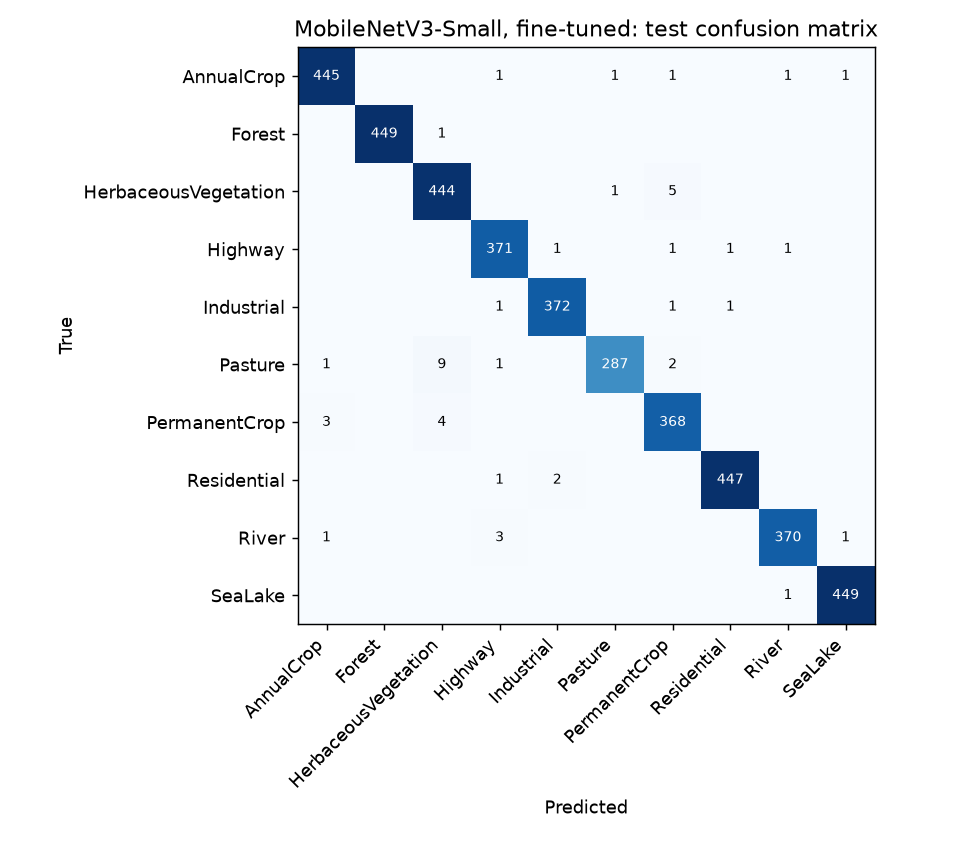

# EuroSAT Land-Cover Classifier

[](https://github.com/24f2006816/eurosat-landcover-classifier/actions/workflows/ci.yml)
[](https://github.com/24f2006816/eurosat-landcover-classifier/actions/workflows/train.yml)

**Classify satellite images by land use: forest, river, highway, crops, residential and more.** This project trains three models on Sentinel-2 satellite tiles and measures how much transfer learning from ImageNet helps compared with training a CNN from scratch, and what it costs in size and speed.

## Results

Test set: 4,050 held-out tiles (15%), measured by the [training workflow](https://github.com/24f2006816/eurosat-landcover-classifier/actions/workflows/train.yml) on a CPU runner.

| Model | Input | Trainable parameters | Test accuracy | Macro-F1 | Training time (CPU) | ms / image (CPU) |
| --- | --- | --- | --- | --- | --- | --- |
| Small CNN from scratch | 64 px | 391K | 95.7% | 0.956 | 20 min | 1.6 |
| MobileNetV3-Small, frozen backbone | 128 px | 601K | 92.0% | 0.917 | 4 min | 3.5 |
| **MobileNetV3-Small, fine-tuned** | 128 px | 1.5M | **98.8%** | **0.988** | 12 min | 3.5 |

- **Fine-tuning wins clearly:** 98.8% accuracy, with 48 errors out of 4,050 against 176 for the from-scratch CNN.
- **Frozen ImageNet features transfer poorly here** (92.0%). Satellite texture is far from ImageNet photos, so the backbone has to adapt, not just the head.
- **The remaining errors are between look-alike vegetation:** pasture taken for herbaceous vegetation (9 tiles) and permanent crop vs herbaceous vegetation (9 both ways). Every class scores an F1 of at least 0.97.



**[Try the live demo](https://huggingface.co/spaces/24f2006816/eurosat-landcover-classifier)** with tiles from the test set.


## Dataset

[EuroSAT](https://github.com/phelber/EuroSAT) RGB (Helber et al., 2019): 27,000 Sentinel-2 tiles of 64×64 pixels across 10 classes (Annual crop, Forest, Herbaceous vegetation, Highway, Industrial, Pasture, Permanent crop, Residential, River, Sea/lake). EuroSAT has no official test split, so the data is split **70/15/15, stratified by class, with a fixed seed**. Validation accuracy picks the best epoch; the test set is used once, at the end.

## Models

| Model | Setup |
| --- | --- |
| Small CNN from scratch | 4 conv blocks (conv, batch norm, ReLU, max-pool), global average pooling, dropout; 64 px input, 15 epochs |
| MobileNetV3-Small, frozen | ImageNet-pretrained backbone frozen, only the classifier head trained; 128 px, 5 epochs |
| MobileNetV3-Small, fine-tuned | All layers trained from ImageNet weights; 128 px, 8 epochs |

Training details: AdamW with cosine learning-rate decay, label smoothing 0.1, and augmentations that suit satellite images, which have no "up": horizontal and vertical flips, 90° rotations, light brightness and contrast jitter.

## Run it

```bash
pip install torch torchvision --index-url https://download.pytorch.org/whl/cpu
pip install -e .
python -m landcover.experiment --export models/landcover.pt   # downloads EuroSAT (~90 MB) on first run
```

## Reproducibility

The **Train and evaluate** workflow trains all three models on a GitHub-hosted CPU runner, writes the results table to the job summary, and publishes the best model, `metrics.json`, the confusion matrix and example tiles to the [`model-v1` release](https://github.com/24f2006816/eurosat-landcover-classifier/releases/tag/model-v1). CI runs 6 tests (split correctness, model shapes, frozen-layer counts, and a training loop that must learn a toy problem) with no downloads.

## Project layout

```
landcover/data.py         EuroSAT loading, stratified split, augmentations
landcover/models.py       small CNN, MobileNetV3 (frozen / fine-tuned)
landcover/train.py        training loop with best-epoch checkpointing, evaluation, latency
landcover/experiment.py   trains and compares all models; writes results/, exports the best one
space/                    Hugging Face Space demo
```

## License

MIT. EuroSAT is by Helber et al. (MIT licence), downloaded by torchvision.
